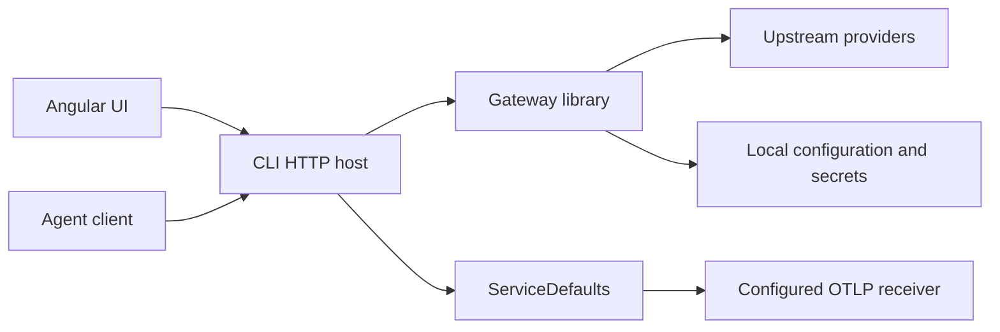

# Project Structure and Architecture Decision

This is a contributor reference. For installation and everyday workflows, start with the [user documentation](../index.md).

## Namespace Convention

Namespaces match the project root and every containing folder. For example, a converter under `src/AgentRouter.Core/Api/Converters` uses `AgentRouter.Core.Api.Converters`, provider code under `Providers/Anthropic` uses `AgentRouter.Core.Providers.Anthropic`, and tests under `tests/AgentRouter.Core.Tests/Unit/Hosting` use `AgentRouter.Core.Tests.Unit.Hosting`.

The root namespaces are `AgentRouter.Core`, `AgentRouter.Cli`, `AgentRouter.ServiceDefaults`, `AgentRouter.Core.Tests`, and `AgentRouter.Cli.Tests`. IDE0130 enforces folder alignment. ServiceDefaults extension methods now belong to `AgentRouter.ServiceDefaults`, not `Microsoft.Extensions.Hosting`. Consumers compiling against previous namespaces must update imports and fully qualified names; assembly and package names are unchanged.

AgentRouter configuration properties and enum output use PascalCase. Shared serialization retains reads of older property casing and legacy enum spellings. External provider/agent protocols keep their own wire names. See [configuration naming](../reference/configuration.md#naming-conventions).

## Decision

Use a modular gateway library with one CLI executable. Keep the existing ServiceDefaults library for OpenTelemetry and health configuration. Add an Angular workspace for the first UI phase, then a thin Electron shell for the second phase. Do not add an Aspire AppHost.

Production assembly consolidation is complete: Core, CLI, and ServiceDefaults remain in the solution. Core dependencies and test references are migrated, and HTTP integration fixtures build the gateway library host using the CLI executable marker. Tests mirror source ownership in Core.Tests and Cli.Tests, each with Unit and Integration folders. Existing cases are preserved under feature folders; ServiceDefaults has no test project. Angular and Electron remain future work.

Assembly boundaries should follow independently consumed APIs, dependency isolation, or independent release needs. The current API, providers, storage, and hosting components ship together and have no demonstrated independent consumers. Folders and internal types can enforce their ownership without a separate assembly per technical layer. This choice is based on this application's deployment model, not the reference application's package count.

## Project Decisions

| Project | Decision | Reason |
| --- | --- | --- |
| AgentRouter.Core | Keep; consolidate gateway implementation here | One reusable ASP.NET Core-capable gateway library. It is not a framework-free domain library. |
| AgentRouter.Cli | Keep | Only .NET executable; commands, process lifecycle, static UI hosting, and packaging. |
| AgentRouter.ServiceDefaults | Keep; tailor defaults | Shared telemetry and health setup, with no orchestration or business policy. |
| AgentRouter.Api | Merge into Core/Api | Protocol adapters and HTTP endpoints are part of the gateway's supported surface. |
| AgentRouter.Providers.OpenAI | Merge into Core/Providers | Current providers share the same shipped SDK family; no plugin/package contract requires isolation. |
| AgentRouter.Hosting | Merge into Core/Hosting | Composition helpers are library APIs, not another independently deployed service. |
| AgentRouter.Storage | Merge into Core/Storage | SQLite and secret storage are implementation details of the local gateway. |
| AgentRouter.Contracts | Merge into Core/Contracts for now | A browser cannot consume a .NET assembly. Generate TypeScript transport types from OpenAPI instead. |
| AgentRouter.Server | Retire after tests migrate to the CLI/library host | Duplicates foreground CLI hosting. Keep only if a real separately packaged server deployment is required. |
| Angular workspace, proposed ui/ | Add in phase 1 | One browser UI consuming authenticated management HTTP APIs. Not a .NET project. |
| Electron workspace, proposed desktop/ | Add in phase 2 | Reuses Angular build and supervises the packaged CLI; no second gateway implementation. |

Extract a provider assembly later only for a separately distributed connector or material dependency isolation. Extract public contracts later only for an actual .NET consumer with a compatibility contract. Do not create empty Application, Domain, Infrastructure, Observability, AgentFramework, or Management projects preemptively.

## Library Boundaries

Within Core, use feature ownership: Providers, Routing, Profiles, Storage, Api, and Hosting. Keep persisted documents, runtime configuration, and public management response DTOs distinct: persisted secrets must never become browser responses. Keep SQLite-specific types behind storage services and protocol serialization inside adapters.

Provider-specific SDK setup and compatibility rules belong in separate provider-owned classes. `Providers/Anthropic/AnthropicProvider.cs` owns native Anthropic registration; `Providers/DeepSeek/DeepSeekToolPolicy.cs` owns DeepSeek request compatibility. Shared OpenAI SDK setup must not contain another provider's rewrite implementation. Composition selects these implementations, while Messages and Responses ingress share the same provider clients. Provider choice is independent of whether the caller is Claude Code, Codex or another compatible agent.

Configuration and profile services own validation and mutations; CLI commands and management endpoints call those same services. Hosting registers dependencies and builds the HTTP pipeline; it should not own provider selection or profile policy. Move configuration/profile services out of Hosting as consolidation proceeds. Routing and profile policy must not depend on Spectre.Console, Electron, or Angular.

Expose a small composition API for consumers of the library: register gateway services, map gateway endpoints, and optionally build a standalone host. Keep implementations internal unless they are intentionally supported extension points. Do not build a generic plugin framework or interfaces around every class.

The executable owns process-wide configuration and calls ServiceDefaults. Consumers embedding the library choose their own exporters and health policy. Moving files into Core alone does not establish these boundaries; namespaces, visibility, dependency registration, and architecture tests must follow them.

## Phase 1: Angular and CLI

The production CLI serves compiled Angular assets and management endpoints, and continues to expose the model gateway. One process may expose separate loopback management and inference listeners; separate listeners do not require separate executables. Management operations must be restricted to the management surface, not exposed on an inference listener configured for remote clients.

Use OpenAPI-defined management DTOs and generated TypeScript types. Angular reads sanitized provider/profile/server state, performs explicit mutations, and never receives stored upstream keys or the master key. Secret input is write-only, and masked placeholders must never overwrite saved secrets. Protect management separately from inference: a model client token must not authorize configuration changes or process launches.

Serve Angular and management APIs same-origin in production; proxy management calls during Angular development. Avoid permissive CORS, credentials in URLs, and untrusted Origin/Host values. Require management authentication and CSRF protection where cookie authentication is used. Keep provider connectivity checks explicit because they can incur upstream charges.

## Phase 2: Electron

Electron loads the same Angular application and launches or reuses the packaged CLI. It owns desktop windows, tray integration, and child-process lifecycle. It must distinguish processes it owns from an existing user-started CLI and stop only owned processes.

Keep Node integration disabled in the renderer, enable context isolation and sandboxing, and expose only minimal validated preload operations. Prefer the same authenticated HTTP management contract as the browser. Do not duplicate provider routing, storage, telemetry, or business rules in IPC handlers.

Gateway readiness, version compatibility, stale state, process identity, and listener conflicts require explicit lifecycle handling before background start/stop or desktop reuse can be advertised.

## Observability Without AppHost

ServiceDefaults is ordinary .NET hosting configuration. It can register OpenTelemetry logs, metrics, traces, and OTLP export without an AppHost. Configure an OTLP receiver externally; Aspire's standalone dashboard is optional, not an application dependency. HTTP/runtime instrumentation is already present, and export is currently enabled only when OTEL_EXPORTER_OTLP_ENDPOINT is set.

Provider registration now negates EnableTelemetry when setting DisableTracing. ServiceDefaults subscribes to the wrappers' Experimental.Microsoft.Extensions.AI activity source and meter, alongside standard HTTP/runtime instrumentation. End-to-end OTLP receiver validation and gateway-specific semantic instrumentation remain separate verification work.

Gateway spans should include requested/resolved model, provider, outcome, latency, and trace correlation. Define request/token/error metrics with bounded labels; never put prompts, session IDs, or request IDs into metric labels. Sensitive AI content now requires Telemetry:EnableSensitiveData=true rather than being enabled automatically in Development.

OTLP export is not a query API or durable request-log store. For Angular observability, choose an external telemetry backend's query integration or a bounded local application request-summary store. Keep telemetry collection in ServiceDefaults, not a duplicate bespoke tracing system. Detailed request/response bodies need separate opt-in capture, redaction, size limits, retention, and access controls. Full agent execution traces require agent-side instrumentation or a supported event protocol; the gateway can observe model requests and reported tool messages, not every local agent action.

Service discovery is unnecessary for fixed configured provider endpoints. Standard HttpClient resilience registration does not by itself prove coverage of OpenAI SDK transports. Review actual provider transport wiring, and define bounded retries deliberately: retries after partial SSE output or on non-idempotent inference requests can duplicate output or charges. Provider failover is routing policy, not automatic parity provided by ServiceDefaults.

## Feature Coverage

Use [protocol compatibility](../integrations.md), the [CLI guide](../guide/cli.md), the [web UI guide](../guide/ui.md), and [observability](../guide/observability.md) as the current user-facing capability documentation. Configuration DTOs alone do not establish support for other policies.

Implementation worklists and historical verification notes belong in the ignored local planning directory, not user documentation. Passing selected tests does not establish full agent or reference-project compatibility.

## Migration Gates

1. Complete one module move at a time, updating packages, framework references, namespaces, and test references without changing behavior.
2. Consolidate tests under Core.Tests and Cli.Tests by feature folders; preserve existing cases and replace Server-based HTTP test fixtures before retiring Server.
3. Build and run deterministic storage, routing, protocol/SSE/tool, authentication, and CLI tests; verify tool packaging and library embedding without a local config side effect.
4. Remove retired project references and files only after migration passes and deletion is approved; leave unrelated work intact.
5. Implement authenticated management APIs and Angular workflows before adding Electron. Track missing reference features separately, not as implied support.
