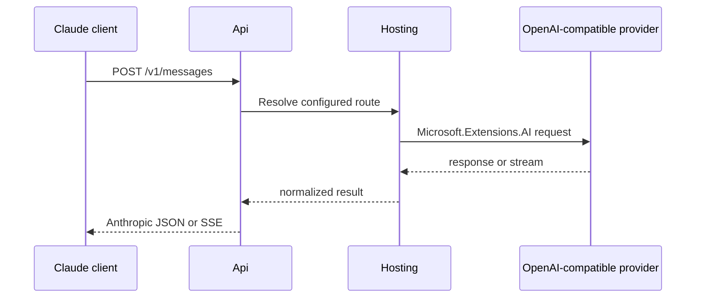
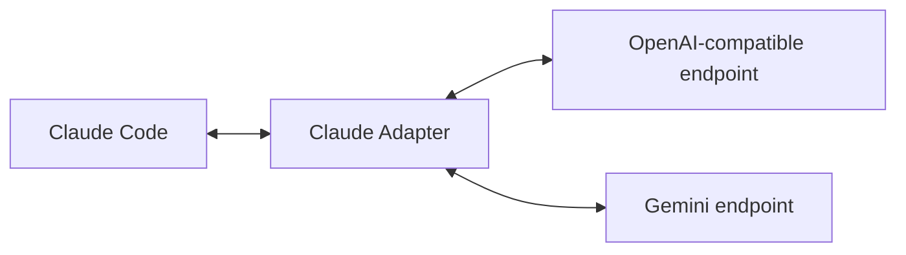

# Features

## Supported capabilities

- API format conversion between Claude, OpenAI, and Gemini formats.
- A bi-directional protocol translation layer for Anthropic messages and OpenAI chat completions.
- Non-streaming and Server-Sent Events (SSE) streaming message responses.
- Anthropic content conversion for text, tool use, and tool results.
- Tool invocation compatibility for tool definitions and function call requests.
- A `/v1/models` endpoint with caching and on-demand refresh.
- Event-driven statistics with today, yesterday, this week, and this month views.
- Interactive CLI initialization for configuration files and environment variables.
- Authenticated local proxying bound to `127.0.0.1` with a generated proxy token.
- Token counting endpoint.
- Configurable default, thinking, and search model routes.
- OpenAI, Azure OpenAI, and GitHub Models provider registration.
- CLI `serve` command and standalone ASP.NET Core server.
- Health checks, OpenTelemetry, resilience, and service discovery defaults.

## Request flow

## Architecture

The gateway acts as a local Anthropic-compatible HTTP server. The protocol translation layer maps system prompts, message history, content blocks, tool definitions, and function calls to the configured upstream format. Responses are converted back to Anthropic JSON or SSE events.

The local proxy listens only on `127.0.0.1` and requires a generated proxy token, so Claude Code can use the gateway without changes to its binary.

## Future direction

- Web/Aspire dashboard and future Electron observability application.

## Code map

- `src/ClaudeCodeGateway.Api/Features/CreatingMessage`: message endpoint.
- `src/ClaudeCodeGateway.Api/Converters`: Anthropic and Microsoft.Extensions.AI conversion.
- `src/ClaudeCodeGateway.Api/ErrorHandling`: Anthropic error mapping.
- `src/ClaudeCodeGateway.Core/Routes`: route model selection.
- `src/ClaudeCodeGateway.Providers.OpenAI`: provider registrations.
- `src/ClaudeCodeGateway.Hosting`: configuration and application composition.
