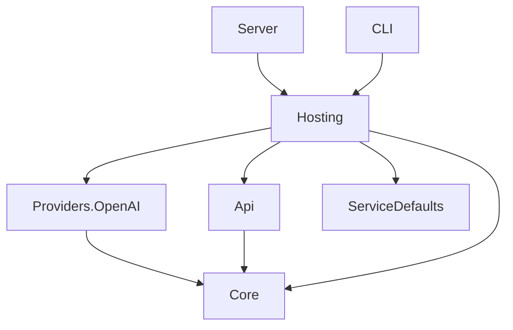

# Project Structure

The repository separates protocol handling, domain policy, provider integrations, host composition, and executable entry points.

```text
src/
  ClaudeCodeGateway.Core/
  ClaudeCodeGateway.Providers.OpenAI/
  ClaudeCodeGateway.Api/
  ClaudeCodeGateway.Hosting/
  ClaudeCodeGateway.Server/
  ClaudeCodeGateway.Cli/
  ClaudeCodeGateway.ServiceDefaults/
tests/
  claude-code-gateway/
  claude-code-gateway-cli/
  shared/
```

## Project responsibilities

- `ClaudeCodeGateway.Core`: dependency-light options, route models, provider contracts, and route resolution.
- `ClaudeCodeGateway.Providers.OpenAI`: Azure OpenAI, OpenAI, and GitHub Models registrations and chat-client wiring.
- `ClaudeCodeGateway.Api`: Anthropic request models, validation, converters, SSE response handling, endpoints, and API errors.
- `ClaudeCodeGateway.Hosting`: configuration providers, options binding, application builder, and dependency-injection composition.
- `ClaudeCodeGateway.Server`: thin ASP.NET Core executable for standalone hosting.
- `ClaudeCodeGateway.Cli`: packaged `claude-code-gateway` tool, Spectre commands, and CLI host lifecycle.
- `ClaudeCodeGateway.ServiceDefaults`: health checks, OpenTelemetry, resilience, and service discovery defaults.

## Dependency direction



Keep protocol behavior in `Api`, provider-specific behavior in provider projects, and startup composition in `Hosting`. `ServiceDefaults` is infrastructure and must not contain gateway domain policy.

Future protocol, provider, storage, management, and desktop projects should be added only when their behavior is implemented.
