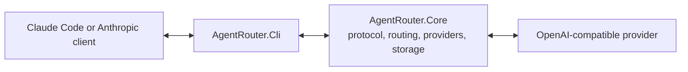

# Agent Router

Agent Router is a model gateway and local control plane for coding agents. Its current inference API accepts Anthropic Messages requests and routes them through Microsoft.Extensions.AI to configured OpenAI-compatible or native Anthropic providers. The CLI command is `ar`.

## Features

- A bi-directional protocol translation layer for Anthropic messages and OpenAI chat completions.
- Server-Sent Events (SSE) streaming for real-time responses.
- Tool invocation compatibility, including tool definitions, function calls, and tool results.
- A `/v1/models` API listing configured enabled models.
- SQLite configuration with encrypted provider credentials and gateway token.
- CLI commands for initialization, providers, tier routes, and isolated Claude Code profiles.
- An authenticated local proxy bound to `127.0.0.1` with a generated proxy token.
- Token counting endpoint and configurable default, thinking, and search model routes.
- OpenAI, native Anthropic, Azure OpenAI, and GitHub Models providers.
- Owned background start/stop, separate management authentication, provider/profile management API, and authenticated OpenAPI.
- CLI HTTP hosting and a reusable gateway library with health checks, telemetry, resilience, and service defaults.
- `.env`, environment variable, Claude settings, and gateway configuration sources.

The current direction is:



## Architecture

The adapter runs as a local HTTP server that mimics the Anthropic API while forwarding requests to a configured OpenAI-compatible target.

```text
Claude Code       Claude Adapter       OpenAI Endpoint
     |                   |                    |
     |  Anthropic ------>|                    |
     |                   |-- OpenAI --------->|
     |                   |<-- OpenAI ----------|
     |<-- Anthropic ----|                    |
```

When Claude Code initiates a request, the adapter transforms system prompts, message history, content blocks, and tool definitions into the configured upstream format. It then converts the response back into Anthropic JSON or SSE events. This keeps Claude Code's interactive behavior intact across different model providers.

## Legacy Configuration

Use a root `.env` file:

```dotenv
GatewayBaseAddress=http://localhost:4000
EnableTelemetry=false
Providers:0:ProviderType=Azure
Providers:0:BaseAddress=https://your-resource-name.openai.azure.com
Providers:0:ApiKey=replace-with-real-api-key
Providers:0:DeploymentName=gpt-4.1
Providers:0:Models:0=gpt-4.1
RouteModel:DefaultModel=azure/gpt-4.1
RouteModel:ThinkingModel=azure/gpt-4.1
RouteModel:SearchModel=azure/gpt-4.1
```

Real environment variables still override `.env` values.

## Quick start

Configure and start on Windows:

```powershell
./ar.ps1 init --port 4600
# Reads OPENAI_API_KEY, or prompts privately for an upstream key.
./ar.ps1 provider add work --base-url https://api.openai.com/v1 --models gpt-4.1
./ar.ps1 provider use work/gpt-4.1
./ar.ps1 profile add Review --model work/gpt-4.1
./ar.ps1 serve
```

Launch Claude Code in another terminal:

```powershell
./ar.ps1 status
./ar.ps1 launch Review
```

The launch profile supplies gateway credentials only to the child process, leaving global Claude settings unchanged. On macOS/Linux use `bash ./ar`; installed tools use `ar`. Full-name repo launchers remain available. Existing `CC_GATEWAY_*` variables and legacy storage/configuration locations remain compatible; no saved credentials are moved. See [CLI reference](docs/reference/cli.md) for commands, connection checks, and token access.

Current scope is model gateway, management backend, and CLI. Electron and Angular UI remain unimplemented. Gemini/Responses protocols, OAuth import, other agent launchers, fallback chains, and ToolHub remain pending. Tool calls are forwarded, not executed by the gateway; no Agent Framework dependency is needed. See [feature coverage](docs/reference/feature-parity.md) for implemented and pending capabilities.

## Repository structure

```text
src/
  AgentRouter.Core/             gateway library: API, providers, routing, storage, hosting
  AgentRouter.Cli/              packaged CLI and HTTP host
  AgentRouter.ServiceDefaults/  health and OpenTelemetry defaults; no AppHost
tests/                                unit and integration tests
docs/                                 user, contributor, and reference docs
```

See [project structure](docs/guide/project-structure.md), [features](docs/features.md), [integrations](docs/integrations.md), and [configuration reference](docs/reference/configuration.md).

## Development

```bash
dotnet build agent-router.slnx --configuration Release
dotnet test --solution agent-router.slnx --configuration Release
```

To package the CLI:

```bash
dotnet pack src/AgentRouter.Cli/AgentRouter.Cli.csproj --configuration Release --output artifacts
dotnet tool install --global AgentRouter --add-source artifacts
ar --help
```
