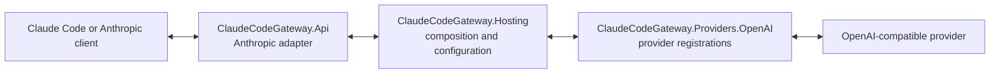

# Claude Code Gateway

Claude Code Gateway is an Anthropic Messages API compatible gateway. It accepts Claude-compatible requests, converts them to Microsoft.Extensions.AI messages, and routes them to configured OpenAI-format providers.

## Features

- API format conversion between Claude, OpenAI, and Gemini formats.
- A bi-directional protocol translation layer for Anthropic messages and OpenAI chat completions.
- Server-Sent Events (SSE) streaming for real-time responses.
- Tool invocation compatibility, including tool definitions, function calls, and tool results.
- A `/v1/models` API with caching and on-demand refresh.
- Event-driven, zero-latency statistics for today, yesterday, this week, and this month.
- Interactive CLI initialization that generates configuration files and environment variables.
- An authenticated local proxy bound to `127.0.0.1` with a generated proxy token.
- Token counting endpoint and configurable default, thinking, and search model routes.
- OpenAI, Azure OpenAI, and GitHub Models providers.
- Local CLI and standalone server hosts with health checks, telemetry, resilience, and service defaults.
- `.env`, environment variable, Claude settings, and gateway configuration sources.

The current direction is:



## Architecture

The adapter runs as a local HTTP server that mimics the Anthropic API while forwarding requests to a configured OpenAI-compatible target.

```text
Claude Code       Claude Adapter       OpenAI Endpoint
     |                   |                    |
     |  Anthropic ------>|                    |
     |                   |-- OpenAI --------->|
     |                   |<-- OpenAI ----------|
     |<-- Anthropic ----|                    |
```

When Claude Code initiates a request, the adapter transforms system prompts, message history, content blocks, and tool definitions into the configured upstream format. It then converts the response back into Anthropic JSON or SSE events. This keeps Claude Code's interactive behavior intact across different model providers.

## Configuration

Use a root `.env` file:

```dotenv
GatewayBaseAddress=http://localhost:4000
EnableTelemetry=false
Providers:0:ProviderType=Azure
Providers:0:BaseAddress=https://your-resource-name.openai.azure.com
Providers:0:ApiKey=replace-with-real-api-key
Providers:0:DeploymentName=gpt-4.1
Providers:0:Models:0=gpt-4.1
RouteModel:DefaultModel=azure/gpt-4.1
RouteModel:ThinkingModel=azure/gpt-4.1
RouteModel:SearchModel=azure/gpt-4.1
```

Real environment variables still override `.env` values.

## Quick start

Point Claude Code to this gateway:

```powershell
$env:ANTHROPIC_AUTH_TOKEN = "test"   # any non-empty value
$env:ANTHROPIC_BASE_URL   = "http://localhost:4600"

claude --model gpt-4.1
```

Start the development host:

```bash
./claude-code-gateway serve --port 4600
```

On Windows, use `./claude-code-gateway.ps1` or `claude-code-gateway.cmd`.

Point Claude Code at it:

```bash
export ANTHROPIC_AUTH_TOKEN=test
export ANTHROPIC_BASE_URL=http://localhost:4600
claude --model gpt-4.1
```

## Repository structure

```text
src/
	ClaudeCodeGateway.Core/             routes, options, provider contracts
	ClaudeCodeGateway.Providers.OpenAI/ OpenAI-compatible provider registrations
	ClaudeCodeGateway.Api/              Anthropic HTTP adapter and converters
	ClaudeCodeGateway.Hosting/          configuration and dependency composition
	ClaudeCodeGateway.Server/           standalone ASP.NET Core executable
	ClaudeCodeGateway.Cli/              packaged CLI and serve command
	ClaudeCodeGateway.ServiceDefaults/  health, telemetry, resilience, discovery
tests/                                unit and integration tests
docs/                                 user, contributor, and reference docs
```

See [project structure](docs/guide/project-structure.md), [features](docs/features.md), [integrations](docs/integrations.md), and [configuration reference](docs/reference/configuration.md).

## Development

```bash
dotnet build claude-code-gateway.slnx --configuration Release
dotnet test --solution claude-code-gateway.slnx --configuration Release
```

To package the CLI:

```bash
dotnet pack src/ClaudeCodeGateway.Cli/ClaudeCodeGateway.Cli.csproj --configuration Release --output artifacts
dotnet tool install --global ClaudeCodeGateway --add-source artifacts
claude-code-gateway --help
```
